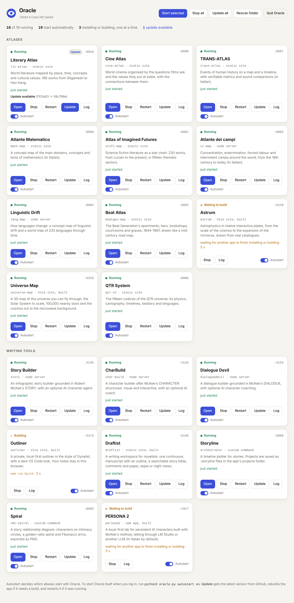

# Oracle

Oracle starts all your web atlases with one command. Put the atlases in one folder (the *atlas folder*). Oracle starts the ones you've selected, each on its own port, and gives you a dashboard at **http://localhost:8800** where you can open, stop, restart and update them. It installs and builds the apps that need a build step (Vite, Next.js and the like) before it starts them. It can also start itself when you log in.



It is a single Python file (`oracle.py`) that uses only the standard library. You need:

- **Python 3.8+** for Oracle itself, for the static atlases and for Storyline and Spiral;
- **Node.js** for the apps that run their own server or need a build: **20.19 or newer** covers them all, except PERSONA 2, which needs **22.12 or newer** (the current Node.js LTS is fine for everything);
- **git** for downloading and updating the atlases.

## Quick start

```bash
git clone https://github.com/fopearcano/oracle.git
```

```bash
cd oracle
```

1. **Tell Oracle where the atlas folder is.** This is the folder that holds the clones (`~/Atlases/lit-atlas`, `~/Atlases/story`, …):

   ```bash
   python3 oracle.py config --db ~/Atlases
   ```

   If you skip this, Oracle uses the `db/` folder next to `oracle.py`.

2. **Fill the folder.** Copy or clone the atlases into it yourself, or let Oracle clone every atlas that is missing and update the ones already there (see [Updates](#updates)):

   ```bash
   python3 oracle.py sync
   ```

3. **Start them:**

   ```bash
   python3 oracle.py
   ```

   The dashboard opens in your browser. Ctrl+C stops Oracle and every atlas it started. The first start of an app with a build step takes a minute or two (see [Apps with a build step](#apps-with-a-build-step)); after that they start at once.

On macOS you can double-click `start-oracle.command`. On Windows, double-click `start-oracle.bat`, which keeps a console window open while Oracle runs, or `start-oracle-hidden.vbs`, which starts Oracle in the background with no window (see [Starting Oracle in the background](#starting-oracle-in-the-background-on-windows)).

## The atlases

Oracle knows these from [`atlases.json`](atlases.json). Each one keeps the port it already used, so your bookmarks keep working. This matters even more for the apps that keep your data in the browser (Outliner, Draftist, Spiral, Storyline, Universe Map, Astrum): the browser files that data under the address, port included, so the same port means the same data.

| Atlas | Port | How it runs |
|---|---|---|
| lit-atlas: Literary Atlas | 8010 | static site |
| cine-atlas: Cine Atlas | 8008 | static site |
| trans-atlas: TRANS-ATLAS | 8007 | static site |
| math-map: Atlante Matematico | 8099 | static site |
| scifi-map: Atlas of Imagined Futures | 8001 | static site |
| cc-map: Atlante dei campi | 8005 | `node server.js` |
| lang-map: Linguistic Drift | 8004 | `node server.js` |
| beatgen-map: Beat Atlas | 8002 | static site |
| astrum: Astrum | 5120 | Vite: built, then `dist/` served as a static site |
| universe-map: Universe Map | 5333 | Vite: built, then `dist/` served as a static site |
| qtr-v2: QTR System | 8006 | static site |
| story: Story Builder | 4135 | `node server.js`, after `npm ci` |
| char-build: CharBuild | 4133 | `node server/index.js`, after `npm ci` |
| dialoguedevil: Dialogue Devil | 4134 | `node server.js`, after `npm ci` |
| outliner: Outliner | 5273 | Vite: built, then `dist/` served as a static site |
| draftist: Draftist | 5146 | built (`npm run build`), then `dist/` served as a static site |
| orchestrator: Storyline | 5000 | its Python server (`app.py`), given Oracle's port and host |
| vdc-spiral: Spiral | 8003 | `python app.py --host … --port …` |
| persona2: PERSONA 2 | 4317 | built, then `npm start` (one server for the API and the interface) |

Oracle serves the static sites itself and tells the browser to re-check every file, so after an update you never get stale scripts.

**Apps that live on a side branch.** story, char-build and dialoguedevil keep their app on a side branch, and their `main` holds only the book. draftist, orchestrator and vdc-spiral have only an empty `main`, with the app on a `codex/…` branch. `atlases.json` names those branches, and Oracle follows them while they exist on GitHub (see [Updates](#updates)).

**Port 5000 on a Mac.** macOS uses port 5000 for AirPlay Receiver, so there Storyline would show as *Already running*. Turn off AirPlay Receiver in System Settings, or give Storyline another port in `atlases.json`. Windows and Linux don't have this problem.

### Adding another atlas

Put its folder in the atlas folder and press **Rescan folder** on the dashboard (or restart Oracle). Oracle works out how to start it:

- a `package.json` with a `build` script → an app with a build step, served or started as described in [Apps with a build step](#apps-with-a-build-step);
- a `package.json` start script like `python3 -m http.server 8010` or `python3 scripts/serve.py 8007` → static site on that port;
- a start script like `node server.js` → Node server, with the port taken from `process.env.PORT || 1234` in that file;
- any other start script → `npm start`;
- just an `index.html` (or `public/index.html`) → static site, with the port taken from `localhost:NNNN` in the README.

If the port is unknown or already taken, Oracle picks a free one from 8100 upward. An app Oracle finds by itself must be started once by hand before Oracle installs or builds it (see [Safety](#safety)). To pin a title, port or start command, add an entry to `atlases.json`:

```json
{ "name": "my-map", "title": "My Map", "kind": "static", "port": 8020 }
{ "name": "api",    "kind": "node", "entry": "src/server.js", "port": 3000 }
{ "name": "odd",    "kind": "cmd",  "cmd": ["{python}", "serve.py", "--port", "{port}"], "port": 8030 }
{ "name": "spa",    "kind": "static", "build": true, "root": "dist", "port": 5200 }
{ "name": "web",    "kind": "server", "framework": "next", "port": 3000 }
{ "name": "two",    "kind": "npm", "build": "build:all", "env": { "API_PORT": "{port}" }, "port": 4000 }
```

Every app gets `PORT` and `HOST` in its environment. `cmd` and `env` can use `{port}`, `{host}`, `{python}` and `{dir}`. The other keys:

| Key | Meaning |
|---|---|
| `kind` | `static` (Oracle serves a folder), `node` (`node <entry>`), `npm` (`npm start`), `server` (a framework's production server, see below) or `cmd` (your own command) |
| `build` | `true` runs the `build` script of package.json, a name such as `"build:web"` runs that script, a list such as `["{python}", "make_site.py"]` runs that command, and `false` never builds. Without it, Oracle builds whenever package.json has a `build` script |
| `root` | for `static`: the folder to serve, such as `"dist"` |
| `framework` | for `server`: `next`, `nuxt`, `sveltekit`, `astro`, `remix` or `react-router` (normally detected) |
| `output` | for `npm`, `node` and `cmd` apps with a build: a file or folder the build makes, so Oracle rebuilds when it is missing |
| `env` | extra environment variables, for apps that read their own names instead of `PORT` and `HOST` |
| `spa` | `false` turns off the fallback to `index.html` for a built static app, `true` turns it on for a plain one |
| `branch` | the branch to follow while it exists on GitHub (see [Updates](#updates)) |

## Updates

Each app follows one branch: the `branch` given in `atlases.json` while that branch still exists on GitHub, otherwise the repository's default branch (the one GitHub shows when you open the repository, such as `main`). So once you merge an app's work into `main`, make `main` the default and delete the old branch, Oracle follows `main` by itself. If you merge but keep the old branch, remove its `branch` line from `atlases.json`, or Oracle keeps following the old branch.

```bash
python3 oracle.py sync
```

For every app in the folder (and every app in `atlases.json` that is missing, which it clones), `sync` fetches the branch the app follows, switches the clone to it if it is on another one, and fast-forwards it. Apps Oracle found by itself are synced too, from the repository they were cloned from. It prints one line per app:

```
  lit-atlas       updated 08c768e -> 1a2b3c4 (main)
  story           already up to date (claude/pensive-clarke-g7vnrx 89f6cb4)
  draftist        switched from 'main' to 'codex/build-draftist-with-enhanced-editing-features': 23e8c8d -> 12c90db
  outliner        skipped: uncommitted changes to src/App.tsx are in the way: commit them, or discard them with `git -C "..." checkout -- src/App.tsx`, then update again
```

`sync` never throws your work away. It doesn't switch a clone that has uncommitted changes, it doesn't fast-forward over local commits that aren't on GitHub, and it doesn't switch a clone to a branch that lacks the app (a `main` with only a book, for example). In each case it says why and changes nothing. `sync story cc-map` syncs just those, and `--selected` only the selected ones.

On the dashboard, **Update** on a card does the same for one app, and **Update all** for every one. Then, if the app was running, Oracle restarts it, rebuilding it first if it has a build step. A plain static site needs no restart: it serves the new files at once. **Rescan folder** also asks GitHub which apps have something new, and their cards show *Update available*. Oracle only asks when you press Rescan folder or Update, never on a timer. The last line of each card tells you how its last update went. If `sync` runs while Oracle is running, Oracle restarts the apps that changed and were running.

## Apps with a build step

Apps written with Vite, React, Next.js and similar tools must be installed and built before they run. Oracle does it for you.

1. **Install.** When `node_modules` is missing, or `package.json` or the lockfile is newer than it, Oracle installs the packages, the development ones (Vite, TypeScript…) included. It uses the package manager that matches the lockfile: `npm ci` for `package-lock.json`, and pnpm or Yarn through Corepack, which comes with Node.js, for `pnpm-lock.yaml` and `yarn.lock`. If a lockfile is out of date, Oracle falls back to a plain install that still leaves the lockfile alone, so the clone stays clean and updates keep working. Bun isn't supported, and the card says so.
2. **Build.** Oracle runs the `build` script before the first start. Afterwards it rebuilds only when the code changed since the last successful build (a new commit, or uncommitted edits), when the lockfile or the build command changed, or when the output is gone. It notes what it built in the `state/` folder next to `oracle.py`, never in the app's own folder. So after an Update brings in new commits, the next start rebuilds by itself; otherwise starting is instant. Neither the install nor the build runs with `NODE_ENV=production`.
3. **Run**, in one of two ways, worked out from `package.json`:
   - **Static output** (Vite, Create React App, Vue CLI, static Astro, SvelteKit with adapter-static, Next.js with `output: 'export'`, `nuxt generate`, Angular, Gatsby, Parcel): Oracle serves the build folder (`dist/`, `build/`, `out/` and so on, or `root` from atlases.json). A path without a file extension that isn't a file, such as `/notes/42`, gets `index.html`, so client-side routes survive a page reload. A missing `/app.js` is still a 404. The port comes from `vite.config` when it sets one.
   - **Server**: Oracle starts the framework's production server on the app's port, and on 127.0.0.1 unless LAN mode is on:

     | Framework | Command |
     |---|---|
     | Next.js | `next start -p PORT -H HOST` |
     | Nuxt | `node .output/server/index.mjs`, with `NITRO_PORT` and `NITRO_HOST` |
     | SvelteKit (adapter-node) | `node build/index.js`, with `PORT`, `HOST` and `ORIGIN=http://localhost:PORT` |
     | Astro (@astrojs/node) | `node dist/server/entry.mjs`, with `PORT` and `HOST` |
     | Remix, React Router | `npm start` (`remix-serve` and `react-router-serve` read `PORT` and `HOST`) |
     | anything else | `npm start`, or `node <file>` when the start script is just that |

     SvelteKit with adapter-auto can't run on your computer; the card says to switch to adapter-node or adapter-static.

The card shows each step: **Installing**, **Building**, **Starting**, **Running**, with how long the step has taken so far. There is no time limit. Oracle installs and builds one app at a time, so starting everything at login doesn't overload the computer; the others show **Waiting to build**. The install and build output goes to the app's log. If a build fails, the card says *Build failed: open the log* and offers **Retry**.

Apps that ignore `PORT`, or read their own variable names, still run: a `cmd` entry passes them the port (Storyline, Spiral), or an `env` entry sets their variables (PERSONA 2). Apps made of several processes started together with `concurrently` are usually like that only in development: PERSONA 2, for example, serves its API and its interface from one process after a build, and that is what Oracle runs. If an app really needs two servers, a `cmd` entry can start both (for example `["npm", "run", "start:all"]`), but Oracle only watches the port it gave the app.

### Safety

Installing and building run the repository's own scripts: an install can run scripts of the packages it installs, and a build can do anything, such as create and fill a database. So:

- apps listed in `atlases.json` may install and build by themselves, at login too;
- an app Oracle finds by itself is never installed or built until you start it once by hand: with its **Start** (or **Restart**, **Retry**) button on the dashboard, or with `python3 oracle.py --only NAME`. Until then its card shows *Needs a first start*, even if it is set to start automatically. *Start selected*, `--all` and the start at login don't count as starting it by hand. Oracle remembers your OK in `state/trusted.json`, for that folder and the repository it came from.

## Choosing which atlases start

Every atlas in the folder starts automatically unless you turn it off. Use the **Autostart** switch on its dashboard card, or:

```bash
python3 oracle.py deselect cc-map lang-map
```

```bash
python3 oracle.py select cc-map
```

```bash
python3 oracle.py list
```

Atlases you add to the folder later start automatically too. For a single run you can override the selection: `python3 oracle.py --only lit-atlas story` starts just those two, and `python3 oracle.py --all` starts everything.

## Starting Oracle when you log in

```bash
python3 oracle.py autostart on
```

This registers Oracle to run in the background at login, without opening a browser. Bookmark http://localhost:8800. `autostart off` removes it, and `autostart status` tells you whether it is on.

| System | What gets installed |
|---|---|
| macOS | `~/Library/LaunchAgents/local.oracle.atlases.plist` (a LaunchAgent) |
| Windows | `Oracle atlases.vbs` in your Startup folder (runs with no console window) |
| Linux | `~/.config/autostart/oracle-atlases.desktop` |

The autostarted Oracle uses the folder set with `config --db`, so set that first. On macOS, keep `oracle.py` and the atlas folder outside Desktop, Documents and Downloads: macOS can block programs started at login from reading those folders.

To stop the background Oracle and all its atlases, use **Quit Oracle** on the dashboard, or run:

```bash
python3 oracle.py stop
```

### Starting Oracle in the background on Windows

Double-click `start-oracle-hidden.vbs`. It starts Oracle with no window and opens the dashboard, or just opens the dashboard if Oracle is already running. It needs Python's `pyw` launcher (it comes with the installer from python.org) or `pythonw`. For an icon on the desktop, right-click the file and choose *Send to > Desktop (create shortcut)*; add ` --no-browser` at the end of the shortcut's *Target* to start Oracle without opening the browser.

Oracle writes its messages to `logs\oracle.log`. If the dashboard doesn't answer within 30 seconds, for example because something else uses port 8800, the script shows the end of that log.

## Using it from a phone or another computer

By default, the atlases and the dashboard listen on this computer only. To open them to your home network:

```bash
python3 oracle.py config --lan on
```

Then apply it to the Oracle that is already running (this also works when Oracle was started at login):

```bash
python3 oracle.py restart
```

To try LAN mode for one run without saving the setting, use `python3 oracle.py restart --lan`.

- **Access code.** Oracle makes one up, such as `k7mp-q2xa`. The dashboard on this computer shows it at the top, together with the address other devices should open, and `python3 oracle.py config` prints it too.
- **On the phone**, open that address (for example `http://192.168.1.20:8800`) and enter the code once. The phone then stays signed in for 30 days. Capital letters, spaces and dashes in the code don't matter.
- **What other devices can do:** open, start, stop, restart and update atlases, download missing ones, and switch Autostart. Only this computer can quit Oracle, so nobody locks you out from the sofa.
- **Changing the code:** `python3 oracle.py config --new-code` makes a new random one, and `python3 oracle.py config --code "your own code"` sets one you choose. Every device that used the old code is asked for the new one.
- **Wrong codes:** after five wrong codes, a device has to wait ten minutes before it can try again.
- **Who can connect:** only devices on a private network, such as home Wi-Fi or a VPN like Tailscale. Public internet addresses are refused, even if you forward the port. The connection is plain HTTP, so use LAN mode on networks you trust: at home, not on café Wi-Fi.
- **The atlases themselves have no code.** With LAN mode on, anyone on the network can open them. The writing tools keep their own protections. Dialogue Devil can ask for its own code if you set `DD_ACCESS_CODE`, and CharBuild lets only this computer change its AI settings. Story Builder lets anyone who reaches it use an API key set on the server, such as `ANTHROPIC_API_KEY`. PERSONA 2 answers only requests addressed to `localhost`: to use it from a phone, add this computer's address to `PERSONA_ALLOWED_HOSTS` in a `.env` file in the persona2 folder (for example `PERSONA_ALLOWED_HOSTS=192.168.1.20`). Anyone on the network can then use it, and the API keys stored in it.
- **Firewall:** the first time, macOS or Windows may ask whether Python or Node may accept incoming connections. Allow it, or other devices won't get through.

### It works on this computer but not on the phone

If the page on the phone keeps loading, or says it can't connect, run this on the computer that runs Oracle:

```bash
python3 oracle.py doctor
```

It checks the usual causes and tells you what to do about each one:

- **Oracle is still private.** If Oracle was already running when you turned LAN mode on (for example, because it starts at login), it keeps listening on this computer only. Running `python3 oracle.py` again just reopens it. `python3 oracle.py restart` fixes that.
- **The firewall.** This is the most common cause. On Windows, it blocks everything on networks marked *Public*, and it remembers a cancelled "allow access" prompt as a block. On macOS, it can block Python or Node.js without asking. `python3 oracle.py doctor --fix` lets Oracle's ports through. Your system asks for your password or for administrator permission first. On Windows the rule only applies to Private networks, so `--fix` also offers to mark the network you use as Private. Answer *y* only for your home network or another one you trust.
- **The wrong address.** VPNs, Docker and virtual machines add extra addresses, and a PC can be on the same network through two adapters. The doctor lists them all. If Oracle shows the wrong one, choose the right one and Oracle uses it everywhere: `python3 oracle.py config --address 192.168.1.117`.
- **WSL.** Oracle running inside WSL can't be reached from other devices. Run it with Windows' own Python instead, by double-clicking `start-oracle.bat`.
- **The phone's side.** The phone must be on the same Wi-Fi, not on mobile data or a guest network, and without a VPN. Some routers keep Wi-Fi devices from seeing each other (*AP isolation* or *client isolation*).

## Commands

| Command | What it does |
|---|---|
| `oracle.py` or `oracle.py start` | Start the selected atlases and the dashboard. Options: `--db DIR`, `--port N`, `--no-browser`, `--lan`, `--all`, `--only NAME…` (`--only` counts as starting those by hand) |
| `oracle.py list` | Show each atlas, its port, whether it starts automatically, and its state |
| `oracle.py select NAME…` / `deselect NAME…` | Turn autostart on or off for these atlases (`--all` for every one) |
| `oracle.py sync [NAME…]` | Clone missing atlases from GitHub, and bring the others up to date on the branch they follow (`--selected` for only the selected ones) |
| `oracle.py stop` | Stop a running Oracle and every atlas it started |
| `oracle.py restart` | Restart Oracle in the background, applying changed settings (`--lan`, `--port N`, `--no-browser`) |
| `oracle.py doctor` | Find out why other devices can't reach Oracle; `--fix` lets it through the firewall |
| `oracle.py config` | Show the settings, or change them with `--db DIR`, `--port N`, `--lan on/off`, `--code CODE`, `--new-code`, `--address IP` |
| `oracle.py autostart on/off/status` | Start Oracle at login |

Settings are saved in `oracle.config.json` next to `oracle.py`, and build records and the apps you allowed to build in `state/`. Neither goes into git. `--db` on a single command, or the `ORACLE_DB` environment variable, overrides the saved folder for that run only.

## Good to know

- **Network access.** Everything listens on this computer only until you turn LAN mode on (see [Using it from a phone or another computer](#using-it-from-a-phone-or-another-computer)).
- **"Already running".** If something already answers on an atlas's port (for example, you started it by hand), Oracle leaves it alone and shows it as *Already running*.
- **Logs.** Each atlas writes its output to `logs/<name>.log`, together with its installs, builds and updates. The dashboard's **Log** button shows the latest part. When an atlas crashes or can't start, the card tells you why.
- **Data kept in the app folder.** Storyline saves projects in a `projects/` folder inside its clone. Updates leave such files alone. Don't delete the clone without copying them first.
- **AI features.** story, char-build and dialoguedevil still take their API key the usual way: in their own Settings, from char-build's `.env`, or from variables such as `ANTHROPIC_API_KEY`. Oracle passes its environment through, so a key that is set when Oracle starts reaches them.

## Tests

```bash
python3 -m unittest discover tests
```
